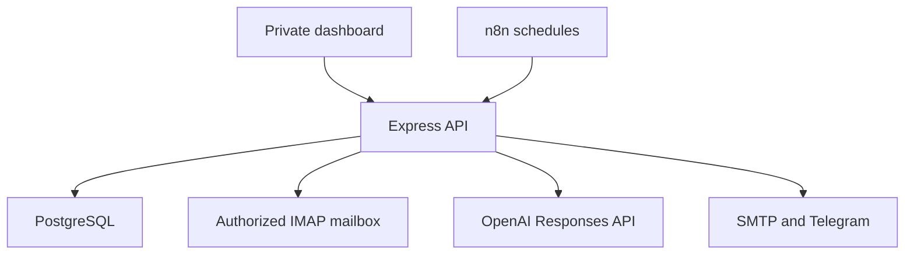
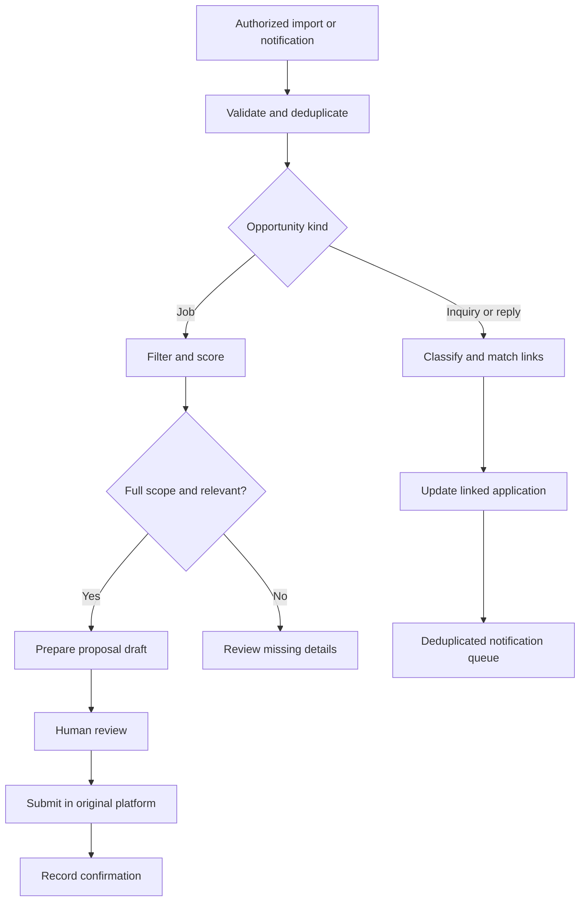

# Architecture and data model

## Runtime topology

The browser communicates only with the same-origin API. Service keys stay in the server environment. n8n sends authenticated workflow triggers; it does not receive raw mailbox content, AI prompts or database credentials for the application. Application and n8n databases use separate PostgreSQL roles. Caddy, when enabled, terminates HTTPS and prevents public access to `/internal/`.

## Opportunity and response flow

There is no automated client-reply sender and no active direct marketplace write adapter. This boundary is reflected in the HTTP API, interface and audit log. Fiverr opportunities stay separate from job applications.

## Database tables

| Table | Purpose and main guarantees |
| --- | --- |
| `users` | One bootstrapped administrator; unique normalized email; salted scrypt password hash. |
| `sessions` | Hashed bearer cookie tokens, per-session CSRF value and expiration. |
| `platform_integrations` | Unique owner/platform, enabled state, actual mode and observed connection state. No provider secrets. |
| `user_preferences` | Validated skills, work/budget filters, profile evidence, daily limits and notification choices. |
| `jobs` | Unique owner/platform/external ID and owner/platform/canonical URL; budget type, source, full-description marker, score and integer revision. |
| `job_skills` | Unique normalized skill per job. |
| `proposal_templates` | Owner's editable style guidance; not evidence for personal claims. |
| `proposals` | Unique job, draft text/estimate/source and explicit review timestamp. |
| `applications` | Unique job, proposal link, lifecycle status, external confirmation and reported spend. Submitted proposal content is retained as a record. |
| `conversations` | Exact canonical link identity or deliberately unlinked message identity; owner-scoped application association. |
| `client_messages` | Unique owner/platform/external message ID, received time, classification source and optional unsent reply draft. |
| `notification_logs` | Unique owner/event/channel, pending/sending/sent/error state, attempts, provider receipt and safe retry time. |
| `workflow_controls` | Individual workflow pause and execution lease. |
| `workflow_runs` | Unique owner/workflow/idempotency key, lifecycle, summary and eligible retry state. |
| `audit_log` | Record of login, preferences, application actions, blocked writes and workflow actions without secret values. |
| `daily_usage` | India-local calendar day AI-call reservation and recorded application count/spend. |
| `mailbox_state` | Mailbox identity, UID validity, monotonic checkpoint, shared intake lease and safe connection error. |
| `email_events` | Durable normalized job/reply events between intake and processing; unique source identity, bounded retries. |
| `schema_migrations` | Applied SQL migration version history. |

Foreign keys and compound owner keys prevent cross-owner associations where relationships carry user scope. API lookups include the authenticated owner. Composite indexes cover recent jobs, ranked jobs, application states, recent replies, notification queue and run history.

## Reliability decisions

**Mail intake:** read-only TLS connection; exact allowed sender and trusted receiver authentication checks; no remote image downloads, link following or attachment retention. Discovery and reply monitoring can independently initiate intake; a shared database lease serializes mailbox access. Every normalized event and its UID checkpoint commit together. Retry cannot silently skip a failed database insert. UID validity or mailbox changes reset the safe lookback scan.

**Job/proposal consistency:** a changed job increments an integer revision. A score or proposal produced for an earlier revision cannot overwrite the edited job's current state. Proposal generation uses a short database lease and the database enforces one proposal/application per job. Preference changes invalidate relevant unsent scores and reviews.

**Reply matching:** exact original job/conversation links are stronger evidence than a client's name or a similar title. Missing evidence yields an unlinked message. An older received message cannot replace a newer application reply state. Classification does not itself accept an offer or send a reply.

**Notifications:** a durable outbox provides source-level duplicate prevention. Known pre-acceptance failures use capped exponential backoff. A timeout or interruption after potential acceptance becomes `unknown`, avoiding a blind resend. Disabled notification workflow delivery remains paused even when another workflow queues notifications.

**Scheduling:** n8n owns schedules; the API owns pause states and idempotency. The daily email uses the Asia/Kolkata calendar day and is sent at 20:00 when the workflow is published and email delivery is configured. Counts labelled “today” use the local day; pipeline counts show current state. No fake seeded counts appear on the dashboard.

**Credentials:** the owner configures service secrets outside the browser. The API returns configuration availability and tested states, not secret contents. n8n credentials are encrypted with its persistent encryption key. Its outgoing webhook bearer token authorizes only the fixed owner and known workflow actions.

## API groups

| Prefix | Scope |
| --- | --- |
| `/api/auth/` | Sign in, get current session and sign out. |
| `/api/jobs`, `/api/import/jobs` | List, import, edit, score and prepare proposals for authorized jobs. |
| `/api/proposals`, `/api/applications` | Review and edit drafts, record external submission, block unsupported direct submissions. |
| `/api/messages`, `/api/import/messages` | Import/read received messages and prepare unsent response drafts. |
| `/api/preferences`, `/api/templates`, `/api/gigs/optimize` | Configure the owner and prepare editable content. |
| `/api/integrations`, `/api/notifications/test` | Inspect connection capability, verify configured providers and send an explicit test to the owner's destinations. |
| `/api/workflows`, `/api/logs` | Toggle, trigger and inspect workflows or retry eligible errors. |
| `/internal/workflows/:name/run` | Bearer-authenticated n8n trigger for the fixed owner, with an optional idempotency key. |

All data routes require a valid session. Mutations also require `X-CSRF-Token`. The health endpoint reveals only database readiness. Lists are bounded/paginated to prevent unbounded payloads; job search is parameterized.

## Capacity and deployment scope

This build targets one owner with a small VPS workload. Workflow batches are bounded; the job listing is paginated, while some working queues show the most recent 200 records. It has no claim of high-volume or multi-tenant capacity testing. See `docs/testing.md` for the actual verification scope.
